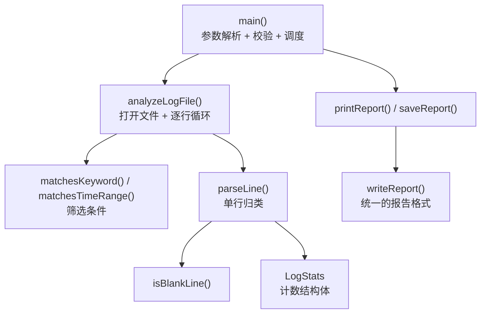

# 架构说明

Linux Log Analyzer —— 用 C++17 写的命令行日志分析工具。

## 1. 一句话定位

读一个日志文件，按「关键词」与「时间范围」筛选，统计 INFO / WARNING / ERROR / 未知级别 / 空行，
把结果同时输出到终端和一个报告文件。

**项目定位**：练习 C++ 的字符串处理、文件流、命令行参数、Linux 命令行工作流与 Git。
功能范围刻意保持很小，重点在把一条完整链路走通。

## 2. 代码组织

单文件：`src/main.cpp`（237 行）。所有逻辑按"从底到顶"排列：



## 3. 三个层次

| 层 | 函数 | 职责 |
|---|---|---|
| **输入与筛选** | `matchesKeyword` `matchesTimeRange` | 决定"这一行要不要参与统计" |
| **统计** | `isBlankLine` `parseLine` + `LogStats` | 把一行归到某一类并累加 |
| **输出** | `writeReport` `printReport` `saveReport` | 同一份格式，写到流或文件 |

`parsing` 与 `output` 之间只通过 `LogStats` 一个结构体耦合，没有其他共享状态。

## 4. 核心数据结构

```cpp
struct LogStats {
    int total_lines = 0;      // 通过筛选的行数（不含被跳过的）
    int info_count = 0;
    int warning_count = 0;
    int error_count = 0;
    int unknown_count = 0;
    int empty_count = 0;
};
```

**注意 `total_lines` 的语义**：它是"**通过筛选后**参与统计的行数"，
不是文件的总行数。这个区分很重要——加了关键词/时间过滤之后，
`total_lines` 会小于文件实际行数。

## 5. 关键设计决策

| 决策 | 理由 | 代价 |
|---|---|---|
| **时间比较直接用字符串 `>=` / `<=`** | `HH:MM:SS` 是定长、补零的格式，字典序与时间序一致 | 只对定长补零格式成立，换成 `9:5:3` 就失效 |
| **`writeReport` 接 `std::ostream&`** | 终端输出与文件输出共用一份格式代码，不会出现"两处格式不一致" | — |
| **筛选在统计之前** | 只有通过筛选的行才计入 `total_lines` 与各级别计数 | 需要向使用者解释清楚这个语义 |
| **`isValidTime` 先查字符再 `stoi`** | 避免 `stoi` 抛异常（非数字字符会让它 throw） | 多一层循环 |
| **关键词为空或 `-` 视为"不过滤"** | 让"只按时间过滤"成为可能（占位符写法） | 文件里真的出现 `-` 时无法按它搜索 |

## 6. 当前边界（如实记录）

| 项 | 现状 |
|---|---|
| 测试 | `tests/` 目录为空，**没有自动化测试** |
| 报告路径 | `reports/analysis_report.txt` **硬编码**在 `main()` 里 |
| 输出目录 | 不自动创建 `reports/`，目录不存在时会写失败 |
| 解析能力 | 只按 ` INFO ` / ` WARNING ` / ` ERROR ` 三个子串判断，不解析完整日志格式 |
| 编码 | 按字节处理，非 UTF-8 文件可能出现异常的"空行"判定 |
