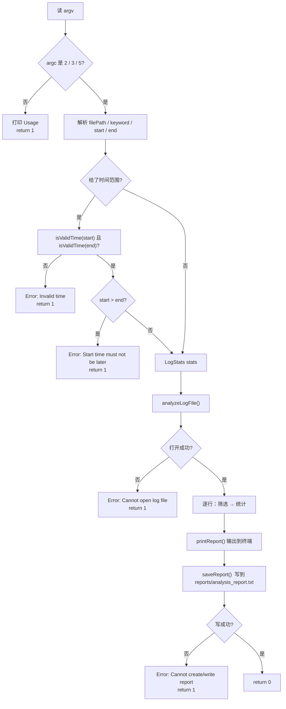
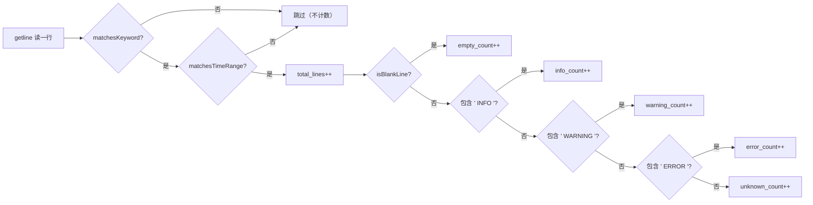

# 执行流程

从一次命令调用到报告落盘的完整链路。

## 1. 三种调用方式

```bash
./log_analyzer <log_file>                                  # 不过滤，统计全部
./log_analyzer <log_file> <keyword>                        # 按关键词过滤
./log_analyzer <log_file> <keyword-or-> <start> <end>      # 关键词 + 时间范围
```

第三种里关键词位置写 `-` 表示"不做关键词过滤"，只按时间筛。

## 2. 主流程



## 3. 逐行处理



**顺序很重要**：先过滤、后分类。被过滤掉的行连 `total_lines` 都不算。

## 4. 各参数的具体语义

| 参数 | 形式 | 为空/占位时的行为 |
|---|---|---|
| `filePath` | 任意路径 | 打不开 → 报错退出 |
| `keyword` | 任意子串 | 空串或 `-` → **不按关键词过滤** |
| `startTime` | `HH:MM:SS` | 空 → 不按时间过滤 |
| `endTime` | `HH:MM:SS` | 空 → 不按时间过滤 |

时间校验做了两层：

1. **格式**：长度必须是 8、第 3 和第 6 位必须是 `:`、其余位必须是数字
2. **范围**：时 0–23、分 0–59、秒 0–59

另外还检查 `start <= end`，否则直接报错。

## 5. 时间匹配的细节

日志行按固定格式处理：

```
2026-10-18 14:23:05 INFO  ...
└─11 位──┘└─8 位─┘
           ↑ substr(11, 8) = "14:23:05"
```

`matchesTimeRange` 会先检查 `line.size() >= 19` 且第 10、13、16 位分别是空格、`:`、`:`；
不满足就判定"这一行不符合时间条件"（跳过）。

然后用**字符串比较**：

```cpp
return logTime >= startTime && logTime <= endTime;
```

对 `HH:MM:SS` 这种定长补零格式，字典序与时间序一致，所以可以直接比。
换成 `9:5:3` 这种不补零的写法就会出错。

## 6. 输出与退出码

报告格式（终端与文件完全一致，因为共用 `writeReport`）：

```
========== Log Analysis ==========
Matched lines: 5
INFO         : 2
WARNING      : 1
ERROR        : 2
Unknown      : 0
Empty lines  : 0
==================================
```

| 退出码 | 含义 |
|---|---|
| `0` | 成功（报告已写出） |
| `1` | 参数错误 / 文件打不开 / 报告写不出 |

## 7. 样例数据与预期结果

`logs/sample.log` 共 5 条记录：

| 级别 | 数量 |
|---|---|
| INFO | 2 |
| WARNING | 1 |
| ERROR | 2 |
| Unknown | 0 |
| 空行 | 0 |
